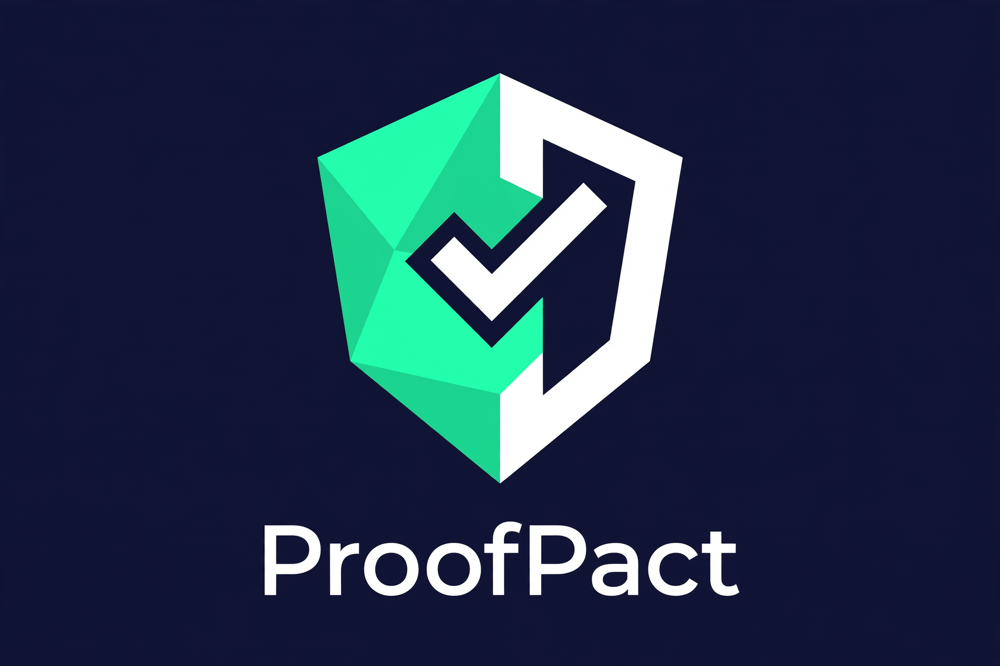

# ProofPact Atlas — enterprise evidence and settlement viewer for NEAR testnet

Multinational operations governance console: organization context, illustrative policy decisions, agent workflows, separated evidence layers, and read-only settlement outcomes.

## Run Locally

**Prerequisites:** Node.js

1. Install dependencies:
   `npm install`
2. Set the `GEMINI_API_KEY` in [.env.local](.env.local) to your Gemini API key
3. Run the app:
   `npm run dev`
